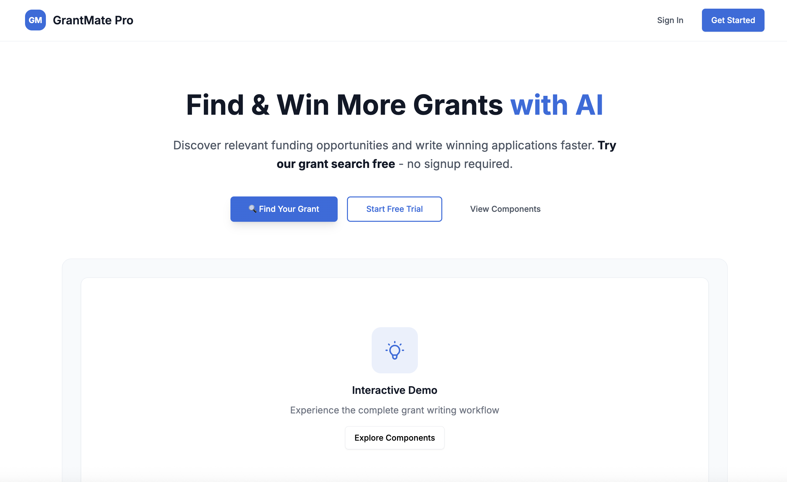

# GrantMate Pro

**AI-assisted grant writing for freelance consultants and boutique firms.**

[Live demo](https://grantmate-pro.vercel.app/) · Built with React, TypeScript, Vite, Tailwind CSS, and Supabase

A web-based SaaS tool that helps freelance grant consultants and boutique firms speed up the grant writing process with AI-assisted workflows. This is a personal product build that I'm developing in the open.




## Project status

This is an MVP in progress. Here's where it stands:

- **Working today:** homepage with product value proposition, email/password and Google sign-in through Supabase, protected routes
- **In progress:** client dashboard, AI application writer wizard, export
- **Planned:** When time permits - grant finder, Stripe-powered freemium model, collaboration portal, team features

## 🎯 Features

- **Homepage:** clear product value proposition and demo call to action
- **Client dashboard:** manage multiple clients and their grant applications
- **AI application writer:** a guided wizard that generates editable draft sections
- **Grant finder:** AI-assisted grant discovery
- **Authentication:** email/password and Google OAuth through Supabase
- **Responsive design:** clean, card-based layouts for web

## 🧱 Tech stack

- **Frontend:** React + TypeScript
- **Build tool:** Vite
- **Styling:** Tailwind CSS with a custom design system
- **UI components:** custom components inspired by shadcn/ui
- **Backend:** Supabase (PostgreSQL, auth, storage)
- **Routing:** React Router DOM
- **AI:** OpenAI API for application drafting and grant discovery

## 🚀 Quick start

### Prerequisites

- Node.js (v16 or higher)
- npm or yarn
- A Supabase account

### Installation

1. **Clone and install dependencies:**

   ```bash
   git clone https://github.com/willshub/grantmate-pro.git
   cd grantmate-pro
   npm install
   ```

2. **Set up environment variables:**

   ```bash
   cp .env.example .env
   ```

   Update `.env` with your own Supabase credentials:

   ```
   VITE_SUPABASE_URL=your_supabase_url_here
   VITE_SUPABASE_ANON_KEY=your_supabase_anon_key_here
   ```

   For the AI features, see [OPENAI_SETUP.md](OPENAI_SETUP.md).

3. **Start the development server:**

   ```bash
   npm run dev
   ```

4. **Open your browser** and go to `http://localhost:5173`

## 🔐 Security notes

Never commit `.env` files or API keys. Supabase's anon key is designed to be public and is protected by row-level security policies, so make sure those are enabled on your tables. Any variable that starts with `VITE_` is bundled into the browser code and visible to anyone who visits the site, so **do not put secret keys such as an OpenAI API key in a `VITE_` variable for a deployed app.** For production, call OpenAI from a server-side function (for example, a Vercel serverless function or Supabase Edge Function) and keep the key there. 

## 🎨 Design system

- **Consultant Blue** `#2D6CDF`: primary brand color
- **Success Green** `#5FD068`: success states and positive actions
- **Background:** white and slate gray variants
- **Font:** Inter (300, 400, 500, 600, 700 weights)

## 📁 Project structure

```
src/
├── components/
│   └── ui/              # Reusable UI components
├── contexts/            # React contexts (Auth, etc.)
├── hooks/               # Custom React hooks
├── lib/                 # Utilities and configurations
├── pages/               # Page components
├── types/               # TypeScript type definitions
└── App.tsx              # Main app component
```

## 🗄️ Data model

- **User:** authentication and subscription management
- **Client:** customer organizations and their details
- **Grant:** funding opportunities and requirements
- **Application:** grant applications with draft sections and status
- **DraftSection:** individual sections of a grant application

## ⚠️ Responsible use

AI-generated drafts and grant suggestions are starting points, not finished work. Always review and edit generated content, and verify grant details, eligibility, and deadlines against the official funder or source (such as Grants.gov) before relying on them.

## 📝 Roadmap

### MVP (Phase 1)

- [x] Project setup and basic structure
- [x] Homepage with clear value proposition
- [x] Authentication system
- [ ] Client dashboard
- [ ] AI application writer wizard
- [ ] Export functionality

### V1 (Phase 2)

- [ ] Freemium model with Stripe integration
- [ ] Grant finder
- [ ] Advanced client management

### V2 (Phase 3)

- [ ] Client collaboration portal
- [ ] Team features for larger firms
- [ ] Advanced AI capabilities

## 🛠️ Available scripts

- `npm run dev`: start the development server
- `npm run build`: build for production
- `npm run preview`: preview the production build
- `npm run lint`: run ESLint

## 📄 License

All rights reserved. The source is visible for portfolio purposes but may not be copied or reused without permission.

## 🤝 Contributing

This is a personal project and I'm not accepting contributions right now. Feedback and questions are welcome: [LinkedIn](https://www.linkedin.com/in/wilsonraphale)
